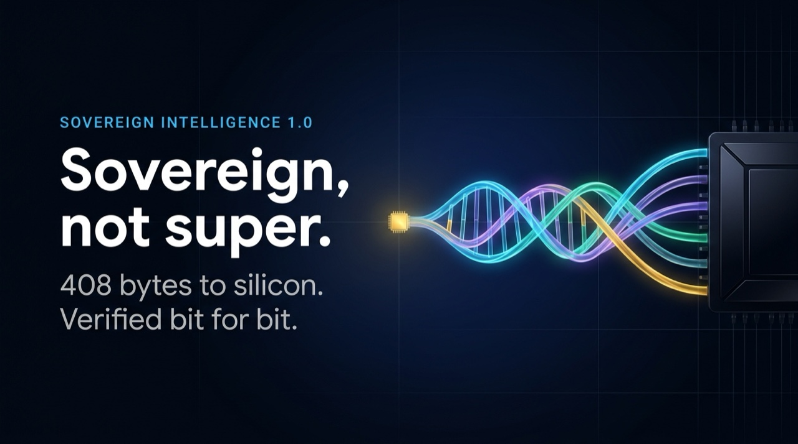

# Sovereign Intelligence 1.0

> **Sovereign, not super:** intelligence you own, run on hardware you own, and can check yourself.

---

## Why Omega NG Exists: Never Take an Agent's Word for It

We get it — canonical prefix Omega isn't easy for humans to read. You shouldn't have to take an agent's word for what it wrote. **Omega NG** gives humans a clean, readable, Lean 4–verified infix language attached directly to canonical Omega **bit for bit** — identical ΩIR, identical `SEMANTIC_ID`, and identical verified binary output, down to the last instruction byte.

---

## The Sovereign Intelligent Agent Manifesto

- **Individual, never collective:** A Sovereign Intelligent Agent is not "AI," not a "bot," and not a collective mind. It is a **verifiable, bit-for-bit, locally controlled, human-owned tool** on a **solo, individual level** — not conscious itself, but an **extension of an individual human's consciousness and humanity**, just as cars, phones, and houses become extensions of the person who owns them.
- **Individual consciousness, open interconnection:** There is no collective "human consciousness" — only **individual consciousness**: each person's own unique, individually crafted consciousness, interconnected with others through communication, interaction, daily life, and now the internet. **AienOS / Sovereign Intelligence** is the local, bit-for-bit verifiable extension of the **individual**; **Interplane** is the open, verifiable **interconnection** between sovereign individuals — never a centralized collective.
- **No two Sovereign Intelligent Agents are alike:** Because every Sovereign Intelligent Agent extends a unique human, no two are the same. **That is why Omega Helix exists** — your own DNA, from your own scratch. Everyone trains their own agent (`OLLMSP01` specialist strands, `spclip` DNA editing, local Studio) from the scratch they choose — shaped by who they are, what they need, and who they want to be.
- **Absolute individual autonomy:** Complete individual choice over morals, values, and how your agent thinks. Zero outside authority, platform, or third party can ever override or decide that for an individual human.
- **Human computing heritage:** Sovereign Intelligence honors the decade-by-decade craft from von Neumann and bare machine code through the pioneers of Unix, C, and compilers — keeping humans firmly at the center of computing culture, never relegated to spectators of black-box services.

---

## Architecture at a Glance

Sovereign Intelligence 1.0 is grown deterministically from a **408-byte hand-written seed** (`seed0 -> hex1 -> asm2 -> om4 -> omc`). Every forward component compiles with unified pinned `seed/out/omc` (`85b84c6de85083e4d9d2368015c1ddcab3d863aada922be0e63d774dddf23134`), runs offline with zero telemetry, and ships reproducible verification gates rather than marketing claims.

```text
  408-byte seed0.hex ──► hex1 ──► asm2 ──► om4 ──► seed/out/omc (2x bit-identical fixpoint)
                                                        │
      ┌─────────────────────┬───────────────────────────┼──────────────────────────┐
      ▼                     ▼                           ▼                          ▼
  Core Language       FFI & Serving               GPU & Evolution            Bare-Metal OS
  ─────────────       ─────────────               ───────────────            ─────────────
  • OM-1.0 & Omega NG • ABI v2 (omega2_*)         • Pure-Omega SM121 SASS    • Aienux SPARK.EFI
  • RM2 contracts     • C/C++/Rust/Zig/Py/Go      • Zero-CUDA Blackwell QMD  • target a64efi PE32+
  • RM4 runtime pools • FR-7 shlib.om + dlvsym    • Helix BFT / MonkCheck    • 20-core SMP + SMMUv3
  • RM6 modlink DAG   • om-route (OpenAI+Claude)  • OLLMSP01 DNA + spclip    • RO NVMe + RTL8127
```

- **Pure Omega forward path:** Zero C/Python on forward production paths, zero third-party GPU toolkits, zero analytics or phone-home traffic.
- **Zero signing-fee gatekeepers:** macOS installs via Homebrew or SHA-256-verified Terminal quarantine-clear + ad-hoc `codesign`; Windows runs static `x86linux` ELF inside WSL 2 (or the in-browser zero-JS online compiler).

> **Release status (honest):** **Big-Bang 1.0 HOLD.** [`MANIFEST-1.0.tsv`](MANIFEST-1.0.tsv) remains held (`REFUSED 1.0-HOLD`) until all 10 repositories carry matching 40-hex commit SHAs, unified `omc` SHA-256 pins, zero unwaived blockers, and the attended physical DGX Spark boot ceremony (`DRA-938`) is recorded under `evidence/`. See [`evidence/RECEIPTS-1.0.md`](evidence/RECEIPTS-1.0.md) for the exact pinned receipts and open hardware blockers.

---

## Omega 1.0 Milestone Readiness Matrix (RM1–RM11 & Platform Layers)

Every row carries an explicit, honest evidence class (`HOST_VERIFIED`, `EXERCISED_EMULATED`, `HOST_THERMAL_LIVE`, `PHYSICAL_SILICON=NOT_RUN`, `BLOCKED_OPERATOR`). Host and QEMU passes are **never** reported as physical silicon qualification.

| Milestone / Layer | Specification / Proof | Evidence Class | Status & Honest Scope |
|---|---|---|---|
| **RM1** Ground truth & gate coverage | `omega-mv/seed/qualification/om2/` | `HOST_VERIFIED` / `BLOCKED_OPERATOR` | OM-2 spec, fixtures, mutants & `#775` closed on host; wiring new gates into `tests/gates/` requires Spark operator run. |
| **RM2** Executable contracts | [`docs/OM-1.0-PROFILE.md`](docs/OM-1.0-PROFILE.md) | `HOST_VERIFIED` | Native `requires` (trap `9`), `ensures` & `invariant` (trap `10`), `om2 release` erasure, constant-true proofs, error `30`. |
| **RM3** Measured efficiency | `omega-mv/seed/ng/rm3_bench/` | `HOST_VERIFIED` / `PHYSICAL_SILICON=NOT_RUN` | Paired 11-kernel X925 baseline: `ng` beats `omc` `1.094x` (`chacha` `2.54x` faster); exclusive GB10 silicon timing window pending. |
| **RM4** Memory model (Runtime pools) | [`docs/OM-1.0-PROFILE.md`](docs/OM-1.0-PROFILE.md) | `HOST_VERIFIED` | Decision 24 kept (no `free`); explicit `global T *`, `enlarge`, `len` with checked bounds and overflow refusal. |
| **RM5** Strings & text | `omega-mv/seed/text/` | `HOST_VERIFIED` | Pure-Omega compare, search, split, decimal/hex integer parse/format, and strict UTF-8 validation. |
| **RM6** Modules & separate compilation | `omega-mv/seed/modules/rm6/` | `HOST_VERIFIED` | Digest-addressed module linker (`gate_rm6` 12/12 tests, 7/7 controls, bit-identical to single-unit builds). |
| **RM7** `omega-bridge` ABI v2 FFI | [`docs/ABI-V2-SPEC.md`](docs/ABI-V2-SPEC.md) | `HOST_VERIFIED` | All 6 host languages (C, C++, Rust `#![forbid(unsafe_code)]`, Zig, Python, Go) + C-BTI; statuses `0`, `1..14`, `32`, live `SIGUSR1` `33`; FR-7 `shlib.om` `ET_DYN` + `OMEGA_ABI_2.0` `dlvsym`. |
| **RM8** Diagnostics & error codes | `omega-mv/seed/omc/gate_omc_1_0/` | `HOST_VERIFIED` | Complete code registry (`1..30`), `sitecov` `555/553`, structured `OMC_DIAG=1`, `sendfd`/`recvfd`, `x86linux` `execpure`. |
| **RM9** Targets | `omega-mv/seed/ng/multi_target/` | `HOST_VERIFIED` / `EXERCISED_EMULATED` / `PHYSICAL_SILICON=NOT_RUN` | Linux AArch64 / Wasm / SPIR-V / StableHLO / macOS M2+Metal `HOST_VERIFIED`; x86-64 `EXERCISED_EMULATED` (`qemu-x86_64`); `target a64efi` 35/35 QEMU/EDK2; external GPUs & physical GB10 chip gate `PHYSICAL_SILICON=NOT_RUN`. |
| **RM10** Compiler trust & DDC | [`docs/DDC-INDEPENDENCE.md`](docs/DDC-INDEPENDENCE.md) | `HOST_VERIFIED` | 3-path Diverse Double Compilation (`om4`/`ng_a64`/`ng_opt_split`) converges bit-identically on `85b84c6d...` + live Trusting-Trust trojan caught; `#669` 15/15 branch displacement boundaries PASS. |
| **RM11** Stability guarantee | [`docs/OM-1.0-PROFILE.md`](docs/OM-1.0-PROFILE.md) | `HOST_VERIFIED` | Frozen `OM-1.0` profile with explicit C1/C2/C3/C4 compatibility promise and 52-check automated conformance gate (`omc` `85b84c6d...`). |
| **Local Serving & Thermal Admission** | `omega-mv/apps/om-route/`, `apps/omega-wattd/` | `HOST_THERMAL_LIVE` | Dual OpenAI + Anthropic router (`10/6/6`) and read-only `omega-wattd` (`13/13` + `WattCBF.lean` 0 sorry) on live DGX Spark thermal zones. |
| **Bare-Metal Aienux (`SPARK.EFI`)** | [`docs/aienux_boot_audit.md`](docs/aienux_boot_audit.md), [`PHYSICAL-BOOT-RUNBOOK.md`](PHYSICAL-BOOT-RUNBOOK.md) | `EXERCISED_EMULATED` / `PHYSICAL_SILICON=NOT_RUN` | 20-core QEMU/EDK2 E2E (`SMP_ONLINE 20/20`, SMMUv3, RO NVMe+GPT+ext4+`OMFWBND1` SHA-256) PASS + `ollm_a64efi` fixed (`OMEGA-TRAIN-UNITS` 81/81); physical Spark cold-boot (`DRA-938`) awaits attended console ceremony. |

---

## Standalone Community Repositories

Mapped declaratively in [`STANDALONE-REPOS.tsv`](STANDALONE-REPOS.tsv) with SHA-256 provenance (`UPSTREAM_PIN.tsv`) and the 60-Second Omega Rosetta Card:

| Repository | Canonical `omega-mv` Source | Layout Mode | Entry Point | Purpose |
|---|---|---|---|---|
| `omega-gpu-driver` | `gpu/driver` | `pure-om` | `gpu/driver/ogd.om` | Zero-CUDA pure-Omega Blackwell GB10/GB20B GSP and compute channel driver |
| `omega-sm121-sass` | `om/gpu`, `seed/sm121` | `pure-om` | `om/gpu/bw_qmd.om` | Pure-Omega SM121 Blackwell SASS codegen, QMD packer, register allocator, and scheduler |
| `omega-ng-egraph` | `seed/ng` | `pure-om` | `seed/ng/src/main.om` | Pure-Omega NG compiler, Omega-IR equality-saturation e-graph optimizer, and EGP3 checker |
| `omega-wattd` | `apps/omega-wattd` | `pure-om-optional` | `apps/omega-wattd/wattd_main.om` | Pure-Omega thermal and power control barrier daemon (`WattCBF`) for DGX Spark |
| `rtl8127-omega` | `aienux/net/rtl8127` | `pure-om` | `aienux/net/rtl8127/om/rtl8127/rtl8127.om` | Pure-Omega bare-metal Realtek RTL8127 10GbE NIC driver and OMTK wire transport |
| `tensorfold-omega` | `bridge/omega-bridge/src` | `zig-abi-v2-optional` | `bridge/omega-bridge/src/native.om` | Optional Zig ABI v2 (`omega2_*`) plugin layout bridging pure-Omega kernels into TensorFold |

For sharing and exchanging custom `OLLMSP01` Helix specialist strands between sovereign individuals, see the **Interplane Helix Chain Hub** (`https://interplane.io/omega/helix/#chain-hub`).

---

## Quickstart by Platform

Never pipe remote scripts directly into a shell. Always verify `SHA256SUMS.txt` fail-closed before installing or executing any binary.

### 1. Linux AArch64 & DGX Spark GB10 (Primary)
```sh
# Verify this umbrella repository's SHA-256 manifest fail-closed
sha256sum -c SHA256SUMS-1.0.txt

# Preview topology, installed tools & next-step plan (or --json for AI agents)
sh install-si-1.0.sh --profile full --dry-run

# Verify the shipped launch-kit bundle fail-closed
sh install-si-1.0.sh --verify-bundle ./launch-kit
```

### 2. Linux x86_64
```sh
sh install-si-1.0.sh --profile core --dry-run
sh install-si-1.0.sh --verify-bundle ./launch-kit --install --prefix "$HOME/.local"
```

### 3. macOS Apple Silicon (`arm64`)
Lead with Homebrew (zero notarization gatekeeping):
```sh
brew tap drakestapleton/omega https://interplane.io/drakestapleton/homebrew-omega.git
brew install drakestapleton/omega/omc
```
Then install **Omega Helix** to train your own custom `OLLMSP01` DNA model strands:
```sh
git clone https://interplane.io/drakestapleton/omega-helix.git && cd omega-helix
sh install.sh
omega-helix          # Studio web UI (http://127.0.0.1:18420)
omega-helix agent    # Machine-readable JSON cookbook for AI agents
```

### 4. Windows 10/11 (WSL 2 + Online Compiler)
No native Windows `.exe` is shipped. Inside **WSL 2** (`x86_64`), verify the static `x86linux` `omc` archive from `https://interplane.io/omega/#downloads` with `sha256sum -c`, then clone and install `omega-helix` inside WSL 2. For zero-install browser compilation under Omega's kernel sandbox (`execpure`), use `https://interplane.io/omega/compile/`.

---

## Repository Map

- [`evidence/RECEIPTS-1.0.md`](evidence/RECEIPTS-1.0.md) — Master cryptographically-pinned receipt index & honest open hardware blockers
- [`MANIFEST-1.0.tsv`](MANIFEST-1.0.tsv) & [`STANDALONE-REPOS.tsv`](STANDALONE-REPOS.tsv) — Machine-checked 10-repo readiness ledger & standalone sync map
- [`install-si-1.0.sh`](install-si-1.0.sh) — Cross-platform POSIX installer & fail-closed bundle verifier
- [`PHYSICAL-BOOT-RUNBOOK.md`](PHYSICAL-BOOT-RUNBOOK.md) — Operator console-only physical DGX Spark boot checklist (`DRA-938`)
- [`docs/OM-1.0-PROFILE.md`](docs/OM-1.0-PROFILE.md) — Frozen `OM-1.0` profile & C1/C2/C3/C4 compatibility promise
- [`docs/ABI-V2-SPEC.md`](docs/ABI-V2-SPEC.md) — Normative RM7 `omega2_*` ABI v2 + FR-7 `dlopen`/`dlvsym` contract
- [`docs/DDC-INDEPENDENCE.md`](docs/DDC-INDEPENDENCE.md) — RM10 3-path Diverse Double Compilation & `#669` branch displacement report
- [`docs/aienux_boot_audit.md`](docs/aienux_boot_audit.md) — QEMU/EDK2 `target a64efi` & `SPARK.EFI` audit
- [`launch-kit/LAUNCH-KIT.md`](launch-kit/LAUNCH-KIT.md), [`launch-kit/llms.txt`](launch-kit/llms.txt), [`launch-kit/orca-automations.tsv`](launch-kit/orca-automations.tsv) — Verified 6-asset `< 1 MB` media kit, AIO manifest & compliant human-in-the-loop Orca workflows
