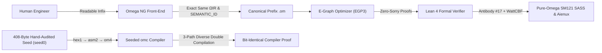
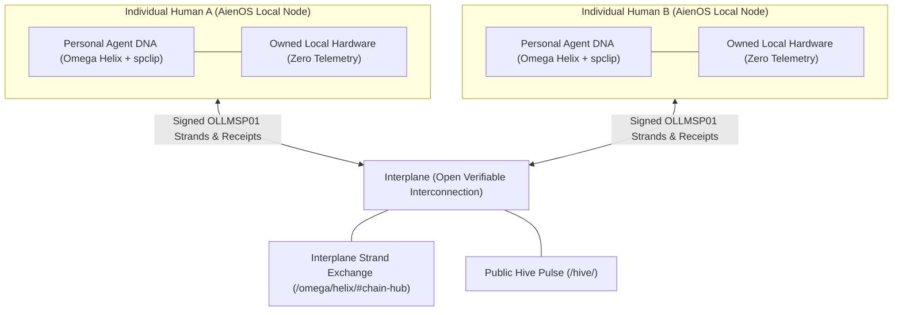
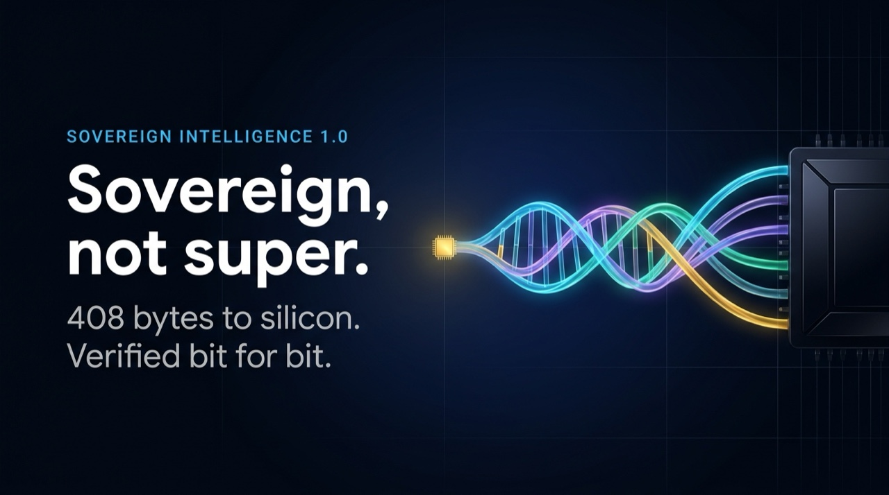
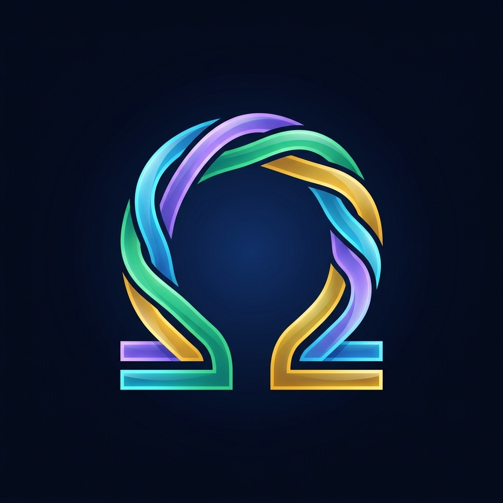
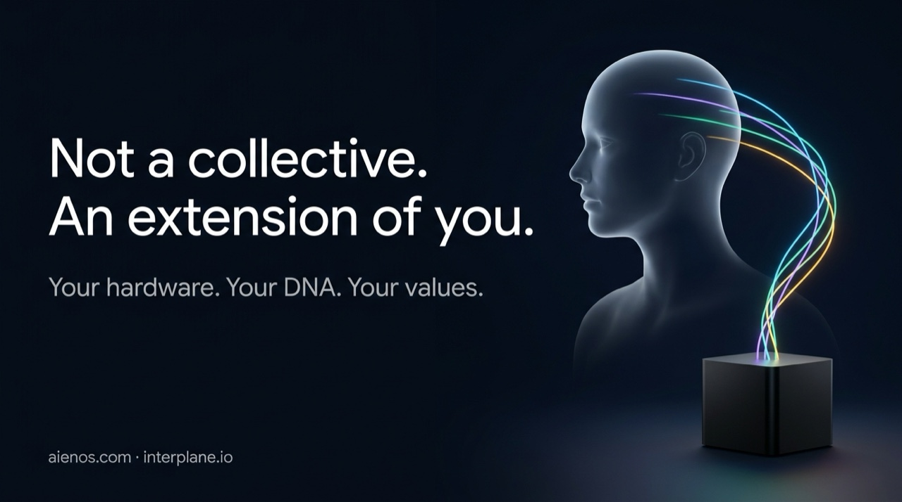
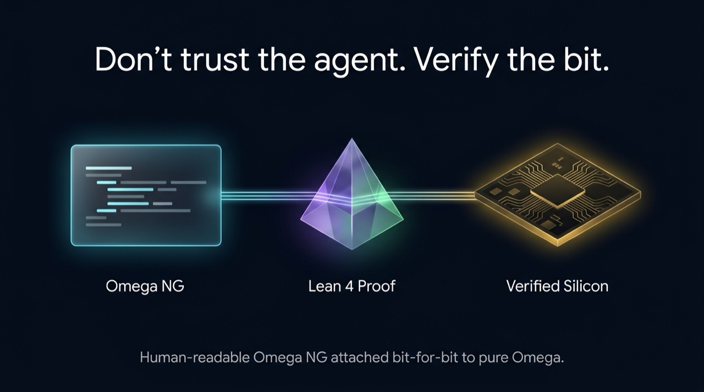
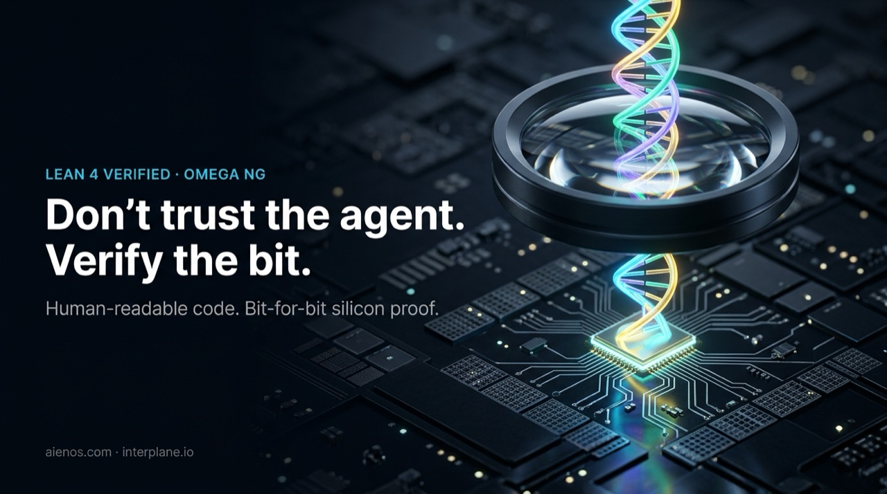
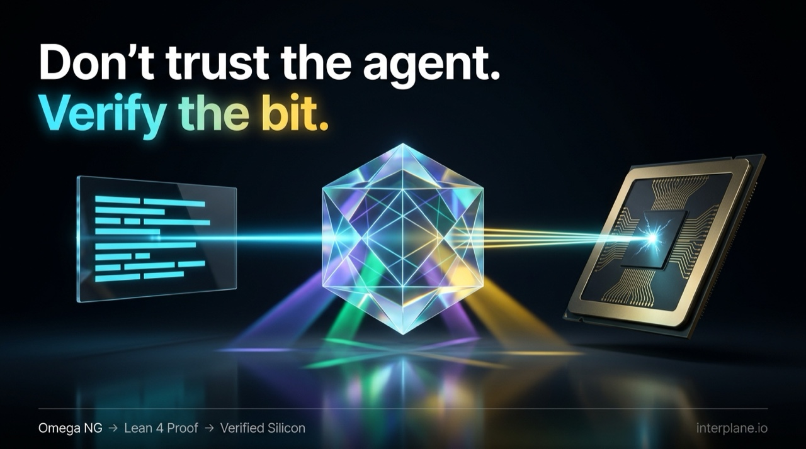

# Sovereign Intelligence 1.0 — Launch Playbook, SEO/AIO Blueprint & Media Kit

> **Strict Big-Bang 1.0 Hold:** Every asset, diagram, post, and automation in this kit is **staged for launch** and held privately until 100% of the Sovereign Intelligence 1.0 verification bar is green and the release signal is given.

---

## 1. Core Positioning — Editorial Spine

Great launches do not shout louder than everyone else — they state one undeniable truth so cleanly that people immediately repeat it in their own words.

| Pillar | One-Line Hook | Why It Resonates |
|---|---|---|
| **Category Reframe** | **Sovereign, not super.** | Replaces trillion-dollar hype with something concrete, personal, and ownable. |
| **Human Manifesto** | **There is no collective "human consciousness" — only individual consciousness.** | Explains why **AienOS** serves the individual and **Interplane** connects individuals without ever building a collective hive mind. |
| **Radical Honesty** | **We get it — canonical prefix Omega isn't easy for humans to read. So we built Lean 4–verified Omega NG attached bit for bit.** | Disarms skepticism on sentence one and turns readability into a machine-checked proof. |
| **The Engineering Proof** | **408 bytes to bare silicon. Zero C on the seed path. Zero external GPU toolkit. Verified by 3 independent compiler paths.** | Systems engineers can run `sh seed/omega-from-seed.sh` in 60 seconds and check the SHA-256 digests themselves. |
| **Personal DNA** | **No two Sovereign Intelligent Agents are alike. Train your own DNA, from your own scratch, with zero outside override.** | Explains *why* Omega Helix, `spclip`, and the Interplane Strand Exchange exist in one sentence. |
| **Human Computing Heritage** | **Standing on their shoulders: from von Neumann and bare machine code through Unix, C, and compilers.** | Keeps humans firmly at the center of computing culture. |

---

## 2. Architectural Diagrams (Ready for READMEs, Sites & Social)

### Diagram A — 408 Bytes to Verified Silicon (The Full Trust Chain)

### Diagram B — Individual Sovereignty ↔ Interplane Interconnection

---

## 3. Search Engine Optimization (Google + GitHub) & AI Search Optimization (AIO)

### A. Google SEO & Zero-JS CSP-Safe Structured Data
Because `interplane.io` enforces a strict `script-src 'none'; style-src 'self'` Content-Security-Policy, **do not break CSP with inline JSON-LD `<script>` tags on `interplane.io`**. Instead:
- Use **Schema.org HTML5 Microdata** (`itemscope itemtype="https://schema.org/SoftwareApplication"`, `itemprop="name"`, `itemprop="applicationCategory"`, `itemprop="operatingSystem"`, `itemprop="codeRepository"`) — parsed cleanly by search crawlers with **zero JavaScript**.
- Every flagship page (`aienos.com/`, `aienos.com/how-its-built/`, `aienos.com/aien/`, `interplane.io/`, `interplane.io/omega/`, `interplane.io/omega/helix/`, `interplane.io/hive/`) carries:
  - Unique `<title>` (`50–60 chars`) leading with primary search intent (`Sovereign Intelligence 1.0`, `Omega Programming Language`, `Pure-Omega GPU Compiler`, `Local AI OS`).
  - Unique `<meta name="description">` (`140–155 chars`) with concrete verifiable metrics (`408-byte seed`, `Lean 4 verified`, `zero telemetry`, `pure Omega`).
  - `<link rel="canonical" href="https://...">`, XML `sitemap.xml`, and clean `robots.txt`.
  - Open Graph (`og:title`, `og:description`, `og:image`, `og:image:width="1280"`, `og:image:height="720"`) and Twitter (`twitter:card="summary_large_image"`) pointing to crisp `< 1 MB` `1280px` JPEGs.

### B. AI Search Optimization (AIO)
AI answer engines prioritize **dense, unambiguous, citation-ready factual pages** over marketing fluff:
1. **`llms.txt`** (bundled alongside this playbook at `llms.txt`, mirrored to `/llms.txt` on `interplane.io` and `aienos.com`): plain Markdown manifest with exact canonical definitions, honest evidence classes (`HOST_VERIFIED`, `EXERCISED_EMULATED`, `HOST_THERMAL_LIVE`, `PHYSICAL_SILICON=NOT_RUN`), and direct links to receipts and repos.
2. **Comparison & FAQ Tables in Semantic `<dl>` / `<table>` Markup:** Answer concrete engineering queries directly (*"How do you verify an AI agent's code?"*, *"How do you bootstrap a compiler without C?"*, *"How do you compile GPU SASS without external toolkits?"*, *"What is the difference between AienOS and Interplane?"*).
3. **Pure-Omega Naming Discipline:** Never promote retired legacy GPU wrapper names on active flagship titles, meta descriptions, or `llms.txt`; keep historical archive URLs intact only where required for link stability.

### C. GitHub Discovery & Repository SEO
- **Umbrella Repository (`sovereign-intelligence`):**
  - **Description (`< 160 chars`):** `Sovereign, not super — 100% pure-Omega AI OS, Lean 4-verified NG compiler, pure-Omega GPU stack & personal Helix DNA trained on hardware you own.`
  - **Topics:** `sovereign-intelligence`, `aienos`, `omega-lang`, `local-ai`, `compiler`, `bootstrap`, `lean4`, `formal-verification`, `gpu-compiler`, `blackwell`, `aarch64`, `operating-system`, `uefi`, `self-hosting`, `llm-inference`, `open-source`, `privacy`, `no-telemetry`, `rust-ffi`.
  - **Above-the-Fold README Formula:** `< 1 MB` 1280px hero banner → Omega NG bit-for-bit honesty & Sovereign Intelligent Agent Manifesto → 1-command `sh seed/omega-from-seed.sh` verification block → honest RM1–RM11 evidence matrix.

---

## 4. Visual Media Kit (`assets/`, Verified `< 1 MB` Ready for GitHub & X)

| Asset | Dimensions & Size | Target Channel |
|---|---|---|
| [`assets/si_1_0_hero_banner.jpg`](assets/si_1_0_hero_banner.jpg) | `1280×714` · **165 KB** | GitHub Social Preview (`sovereign-intelligence`), X Header / Pin, `og:image` |
| [`assets/si_1_0_avatar.jpg`](assets/si_1_0_avatar.jpg) | `1024×1024` · **142 KB** | Official X Avatar, Org Avatar, Site Emblem |
| [`assets/si_ad_individual_sovereignty.jpg`](assets/si_ad_individual_sovereignty.jpg) | `1280×714` · **143 KB** | Editorial Card #1 — *"Not a collective. An extension of you."* |
| [`assets/si_ad_verify_the_bit.jpg`](assets/si_ad_verify_the_bit.jpg) | `1280×714` · **145 KB** | Editorial Card #2 — *"Don't trust the agent. Verify the bit."* |
| [`assets/si_ad_verify_bit_macro.jpg`](assets/si_ad_verify_bit_macro.jpg) | `1280×714` · **231 KB** | Editorial Card #3 — *"Verify the bit"* (Macro Silicon Close-Up) |
| [`assets/si_ad_verify_bit_prism.jpg`](assets/si_ad_verify_bit_prism.jpg) | `1280×714` · **190 KB** | Editorial Card #4 — *"Verify the bit"* (Optical Prism Variant) |

---

## 5. Multi-Channel Launch Copy Pack (Held Until 1.0 Green)

### A. Official X Account Blueprint
- **Display Name:** `Sovereign Intelligence` (or `AienOS · Sovereign Intelligence`)
- **Bio (`<= 160 chars`):** `Sovereign, not super. 408 bytes to bare silicon. Lean 4-verified Omega NG, pure-Omega GPU stack & personal agent DNA on hardware you own. aienos.com · interplane.io`
- **Pinned Launch Thread (8 Posts):**
  1. **[Hero Banner]** *Sovereign, not super.* Launching Sovereign Intelligence 1.0: a pure-Omega compiler, Lean 4 formal verification pipeline, pure-Omega Blackwell GPU stack, and personal training studio bootstrapped from a 408-byte seed. Zero C on the seed path. Zero telemetry. Verify every bit yourself.
  2. **[Card: Individual Sovereignty]** There is no collective "human consciousness" — only individual consciousness: each person crafting their own mind, interconnected through conversation, daily life, and the internet. A Sovereign Intelligent Agent is a verifiable, bit-for-bit, locally controlled tool extending *your* mind — like a car, a phone, or a home.
  3. **[Card: Verify the Bit]** We get it — canonical prefix Omega isn't easy for humans to read. You should never have to take an agent's word for what it wrote. Omega NG gives humans a clean, readable, Lean 4–verified infix language attached directly to canonical Omega **bit for bit** (identical ΩIR, `SEMANTIC_ID`, and verified binary bytes).
  4. **[Diagram A: 408 Bytes → Silicon]** How do you trust a compiler? Run Diverse Double Compilation across **3 independent paths** (`om4`, `ng a64`, and `ng opt+split`) and watch all three emit the exact same compiler binary down to the last SHA-256 bit — plus a live Trusting-Trust trojan negative control caught fail-closed.
  5. **[Personal DNA / Omega Helix]** No two humans are alike — so no two Sovereign Intelligent Agents are alike. **Omega Helix** + editable `spclip` lets you train your own DNA from the scratch you choose, with your own morals and values and zero outside override. Share specialist strands openly on Interplane.
  6. **[Pure-Omega GPU & Formal Safety]** Pure seeded-Omega SM121 SASS targets Blackwell Tensor Cores directly with zero external GPU toolkit, guarded by Lean 4 proofs (`WattCBF.lean` + Antibody `#17` 47/47 production kernels with 0 hazards; host-verified, physical silicon receipt tracked separately).
  7. **[Human Computing Heritage]** Honoring the decade-by-decade craft from von Neumann and bare machine code through the pioneers of Unix, C, and compilers — keeping humans firmly at the center of computing culture. Full transparent build log: `https://aienos.com/how-its-built/`
  8. **[Call to Verify]** Do not take our word for a single claim. Clone the seed, rebuild the compiler twice, verify the SHA-256s, and inspect the Lean 4 proofs directly at `https://interplane.io` and `https://aienos.com`.

### B. Hacker News `Show HN` Angle
- **Title:** `Show HN: Sovereign Intelligence 1.0 – 408-byte-seeded compiler, Lean 4 NG infix, pure-Omega GPU stack`
- **Opening Body:** Lead immediately with the reproducible 60-second verification command (`sh seed/omega-from-seed.sh`), honest admission that prefix `.om` is hard to read (leading to Lean 4–verified Omega NG infix attached bit-for-bit), 3-path Diverse Double Compilation proof, and strict separation of `HOST_VERIFIED` vs `EXERCISED_EMULATED` vs `PHYSICAL_SILICON` claims.

### C. Technical Community Angles (`r/LocalLLaMA`, `r/ProgrammingLanguages`)
- **`r/LocalLLaMA`:** Pure-Omega local serving (`om-route` dual OpenAI + Anthropic + live thermal admission, `q36-35b` 128K context, `omega-helix` editable `spclip` personal DNA strands with zero cloud override).
- **`r/ProgrammingLanguages`:** Dual prefix/infix surface lowering to identical ΩIR + `SEMANTIC_ID`, E-graph `EGP3` optimizer with Lean 4 proofs (`0 sorry`), RM6 digest-addressed separate compilation, RM7 6-language ABI v2 + FR-7 `dlopen`/`dlvsym`, and 3-path Diverse Double Compilation.

---

## 6. Compliant Human-in-the-Loop Orca Automation Plan

> **Strict Integrity & ToS Boundary:** The official account is created and owned directly by the project author. Orca workflows **never** operate multiple or fake accounts, **never** automate bulk likes/follows/retweets/votes, **never** scrape credentials, and require **1-click human approval** before publishing anything external.

See [`orca-automations.tsv`](orca-automations.tsv) for the declarative workflow table covering:
1. `launch-receipt-drafter` — drafts verified release posts with exact SHA-256 receipts into a local review queue (human 1-click approval required).
2. `community-qa-researcher` — grounds technical Q&A drafts strictly in real repo commits, `OM-1.0-PROFILE.md`, and runnable verification commands (human review required).
3. `seo-aio-health-watch` — nightly read-only HTTP 200, `< 1 MB` asset, `/llms.txt`, and zero-JS CSP health monitor (read-only alert on failure).
